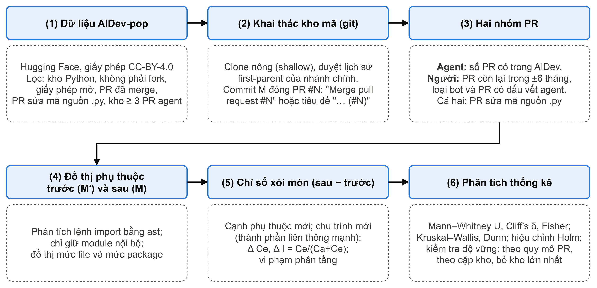
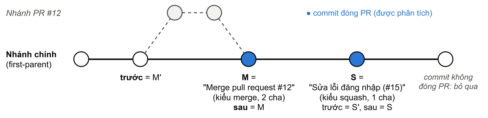

# Signs of Architecture Erosion in Pull Requests of AI Coding Agents

*An empirical study on the AIDev dataset*

[](https://www.python.org/)
[](LICENSE)
[](https://huggingface.co/datasets/hao-li/AIDev)
[](https://arxiv.org/abs/2602.09185)

Measurement pipeline for the study *Signs of architecture erosion in pull requests of AI coding agents: an empirical
study on the AIDev dataset* (Võ Hoàng Anh, Faculty of Information Technology, HUFLIT, 2026).
Vietnamese title: *Dấu hiệu xói mòn kiến trúc trong pull request của AI coding agent: nghiên cứu thực nghiệm trên
bộ dữ liệu AIDev*.

**Contents:** [Overview](#overview) · [Research questions](#research-questions) · [Method](#method) ·
[Reproducing the results](#reproducing-the-results) · [Validation](#validation) · [Figures](#figures) ·
[License](#license) · [Contact](#contact)

## Overview

AI coding agents such as OpenAI Codex, GitHub Copilot, Cursor, Devin and Claude Code now open pull requests (PRs) on
their own. This study examines whether those PRs leave more signs of architecture erosion in the dependency
structure of a project than PRs written by people in the same repositories. For every merged PR, the tool builds
the import graph between Python modules before and after the PR, directly from git history, and measures what the
PR changed: new dependencies, packages brought into dependency cycles, coupling (Ce, I) and layering violations.

> **Tóm tắt.** Kho mã này chứa quy trình đo của nghiên cứu: lọc dữ liệu, khai thác kho mã, dựng đồ thị phụ thuộc,
> tính chỉ số, phân tích thống kê và vẽ hình. Với mỗi pull request (PR) đã merge trong các kho Python lấy từ bộ dữ
> liệu AIDev, công cụ dựng đồ thị import giữa các module tại commit trước và sau PR, rồi so sánh PR của AI coding agent
> với PR của người trong cùng kho về cạnh phụ thuộc mới, chu trình giữa các package, độ ghép nối (Ce, I) và vi phạm
> phân tầng.

**Data source.** AIDev by Li, Zhang and Hassan: dataset
[huggingface.co/datasets/hao-li/AIDev](https://huggingface.co/datasets/hao-li/AIDev), code
[github.com/SAILResearch/AI_Teammates_in_SE3](https://github.com/SAILResearch/AI_Teammates_in_SE3), paper
[arXiv:2602.09185](https://arxiv.org/abs/2602.09185). This study uses the AIDev-pop subset (repositories with more
than 100 stars) at revision `7840b6e`.

> [!NOTE]
> The measurement pipeline and its validation are public. Results (tables, result figures and the per-PR metrics)
> will be added to this repository when the paper is published.

<p align="center">
  
  <br><em>Figure 1. Measurement pipeline: from the AIDev agent PRs to the statistical analysis.</em>
</p>

## Research questions

- **RQ1.** Do agent PRs add dependency cycles and coupling more than human PRs in the same repositories?
- **RQ2 (exploratory).** Do agent PRs violate layering more often? Most repositories declare no layer rules, so
  layers are mostly inferred from directory names.
- **RQ3.** How do the agents differ (OpenAI Codex, GitHub Copilot, Cursor, Devin, Claude Code, Google Jules)?
  Agents with fewer than 30 analysed PRs are left out of this comparison.

## Method

1. **Agent PRs.** AIDev-pop (Hugging Face `hao-li/AIDev`, revision `7840b6e`) filtered to Python repositories that
   are not forks, have a reuse-permitting open-source license, and have at least 3 merged agent PRs that change
   Python source code.
2. **Finding PRs in git, without the GitHub API.** Each repository is cloned (bare, shallow from 200 days before its
   first agent PR, blobs larger than 1 MB skipped). On the default branch's first-parent history, a commit titled
   `Merge pull request #N ...` (merge) or ending with `(#N)` (squash) closes PR *N*. The state before the PR is the
   commit's first parent `M′`; the state after is `M`.

   <p align="center">
     
     <br><em>Figure 2. A merge commit or a squash commit on the first-parent chain closes a PR; the PR's change is
     the diff between <code>M′</code> and <code>M</code> in both cases.</em>
   </p>

3. **Two groups.** PR numbers listed in AIDev form the agent group. Other PRs merged within ±182 days of the
   repository's agent PRs form the human group, after removing bots, agent accounts and PRs with agent traces
   (agent co-authors, generated-by messages, agent branch names). At most 300 human PRs per repository are sampled
   (seed `42 + crc32(repository)`).
4. **Dependency graph.** Every Python source file (tests, docs, examples and `setup.py` excluded) is parsed with
   `ast`; each import is resolved to the longest matching internal module (relative imports, `src/` layouts,
   sub-directory roots). Renamed files are detected with `git diff -M`, so moving a file is not counted as new
   dependencies. Each import is tagged by where it sits (module level, inside a function, under
   `if TYPE_CHECKING:`); the main graph leaves out type-checking-only imports, and two variants (all imports,
   module-level imports only) are kept for sensitivity analysis. Graphs are built at file and package level.
5. **Metrics (after minus before).**

   | Metric | Definition |
   |---|---|
   | New edges | file-to-file and package-to-package imports added by the PR |
   | C_new | a package that was in no dependency cycle joins one (strongly connected component of at least two packages) |
   | C_exist | an edge is only added inside cycles that already existed |
   | Δ Ce | change in efferent coupling of the packages the PR changes |
   | Δ I | change in instability I = Ce/(Ca + Ce) of the core packages (top 10% by Ca, ties broken by package name) |
   | Layering violations | new edges against the layers (import-linter `layers` contracts when present, otherwise a conservative directory-name heuristic) |

6. **Statistics.** Mann–Whitney U with Cliff's δ, Fisher's exact test, Kruskal–Wallis with Dunn's post-hoc test,
   Holm correction within each test family, α = 0.05; logistic GEE with PRs clustered by repository, controlling for
   PR size, merge style, merge date and repository size (for RQ3 also with Claude Code separated from the other
   agents). Robustness checks: comparison within PR-size quartiles, repository-paired Wilcoxon test, re-analysis
   without the repository with the most agent PRs and without OpenAI Codex, alternative graphs, core-package
   thresholds of 5% and 20%, and a correction for agent PRs hidden in the human group.

## Reproducing the results

**Requirements**

- Windows, macOS or Linux with `git` 2.45 or newer (`GIT_NO_LAZY_FETCH` is used for partial clones)
- [uv](https://docs.astral.sh/uv/), which installs Python 3.12 and the pinned dependencies from `uv.lock`
- About 20 GB of free disk space during mining (each clone is removed after its repository is processed)
- No GitHub token: everything goes through `git` and public github.com URLs

**Commands**

```bash
uv python install 3.12
uv sync
uv run python scripts/00_check_env.py        # environment report
uv run pytest -q                             # 19 unit tests

uv run python scripts/01_download_aidev.py   # ~1.4 GB, pinned dataset revision
uv run python scripts/02_filter_agent_prs.py
uv run python scripts/03_mine_repos.py --workers 8   # several hours; resumable
uv run python scripts/04_layer_violations.py
uv run python scripts/03b_core_sensitivity.py --workers 4   # Δ I at 5%, 10%, 20%; resumable
uv run python scripts/05b_review_violations.py
uv run python scripts/05c_screen_human_prs.py # screens human PRs for agent traces on github.com
uv run python scripts/06_statistics.py
uv run python scripts/07_figures.py
uv run python scripts/07_figures.py --lang en   # English labels, *_en files
uv run python scripts/08_numbers.py          # numbers.json and claims.json
```

`03_mine_repos.py` caches each repository in `data/interim/mined/` and can be stopped and restarted.
Useful options: `--repos owner/name ...` to mine selected repositories, `--retry-errors` to re-mine
repositories that failed for transient reasons (network, machine sleep), `--limit N` for a trial run.
Repositories deleted from GitHub are reported and excluded.

`05b_review_violations.py` lists every flagged layering edge with its commit link so that it can be compared with
the source code (`verdict` and `reason` columns). `05c_screen_human_prs.py` estimates how many "human" PRs were
made with an agent: it downloads 50 randomly drawn human PR pages from github.com and searches them for agent
branch names, agent footers in the PR description, agent co-author trailers, agent links and agent bot accounts.

### Pipeline

| Step | Script | Main outputs |
|:---:|---|---|
| 00 | `00_check_env.py` | environment report |
| 01 | `01_download_aidev.py` | `data/raw/aidev/*.parquet`, `schema.json` |
| 02 | `02_filter_agent_prs.py` | `data/interim/agent_prs.csv`, `results/logs/filter_funnel.csv` |
| 03 | `03_mine_repos.py` | `data/interim/mined/`, `data/interim/mined_prs.csv`, `results/logs/mining_repos.csv` |
| 04 | `04_layer_violations.py` | `data/processed/pr_metrics.csv`, `data/processed/violations.jsonl`, `config/layer_rules/*.json` |
| 03b | `03b_core_sensitivity.py` | `data/interim/core_sensitivity/`, `results/tables/core_sensitivity.csv` (Δ I of the core packages at 5%, 10%, 20%; step 06 takes the main Δ I from the 10% column) |
| 05b | `05b_review_violations.py` | `results/manual_check/violations_review.csv` |
| 05c | `05c_screen_human_prs.py` | `results/manual_check/human_screen.csv` |
| 06 | `06_statistics.py` | `results/tables/*.csv` (incl. GEE regression, sensitivity), `stats_summary.json` |
| 07 | `07_figures.py` | `results/figures/fig3`–`fig7` (PNG 300 dpi and SVG) |
| 08 | `08_numbers.py` | `results/tables/numbers.json`, `claims.json` |

Every script appends a record (code commit, time, parameters, outputs) to `results/logs/runs.jsonl`.
All thresholds, seeds and paths are in `config/settings.yaml`.

<details>
<summary><b>Main output: <code>data/processed/pr_metrics.csv</code> (one row per PR)</b></summary>
<br>

| Column | Meaning |
|---|---|
| `repo`, `number`, `group`, `agent` | repository, PR number, `agent` / `human`, agent name or `Human` |
| `sha_before`, `sha_after`, `merge_style` | commits `M′` and `M`; `merge` or `squash` |
| `status` | `ok`, `not_on_first_parent`, `no_py_source_change` or `error` |
| `loc_changed`, `files_changed`, `py_files_changed` | PR size |
| `added_edges`, `removed_edges`, `edges_per_file`, `added_pkg_edges` | dependency changes |
| `cycle_new_pkgs`, `cycle_existing_only`, `new_cycle`, `d_cyclic_pkgs`, `d_cyclic_modules` | cycle changes |
| `added_edges_all`, `added_edges_top`, `cycle_new_pkgs_all`, … | the same indicators on the alternative graphs |
| `pkgs_touched` | packages whose source files the PR changes |
| `d_ce_mean`, `d_i_core` | coupling and instability changes |
| `new_violations`, `has_violation`, `rq2_eligible`, `layer_source` | layering |
| `renamed_py`, `rename_detection`, `missing_blobs`, `parse_errors` | data-quality flags |

Commit author names and e-mail addresses are removed from this file.

</details>

## Validation

| Check | Description | Output |
|---|---|---|
| Unit tests | 19 tests: import resolution (absolute, relative, `src/` as a layout or as a package, sub-directory roots, external libraries sharing a name with an internal module), test-file filter, renamed files, graph metrics on a small git repository, layer rules (heuristic and import-linter), core packages with tied Ca | `tests/` |
| Comparison with diffs | During development, samples of 20 PRs (10 agent, 10 human) were compared with their diffs on GitHub after each run; every error found was fixed, covered by a test, and all data were recomputed | project log |
| Layering violations | Every flagged edge compared with the source code | `results/manual_check/violations_review.csv` |
| Human-group screening | 50 random human PR pages checked for agent traces | `results/manual_check/human_screen.csv` |
| Claims | Every qualitative statement of the paper checked against the results | `results/tables/claims.json` |

The tool has not yet been evaluated independently on a separate random sample.

## Figures

| Paper figure | File | Made with |
|---|---|---|
| 1. Measurement pipeline | `fig1_pipeline` | draw.io |
| 2. Identifying PRs in git history | `fig_pr_identification` | draw.io |
| 3. Metric example (new edge, C_new, layering violation) | `fig2_metric_example` | draw.io |
| 4. Rates per metric and group | `fig3_rates_by_group` | `scripts/07_figures.py` |
| 5. Rates by PR-size quartile | `fig4_size_strata` | `scripts/07_figures.py` |
| 6. Distribution of new edges (ECDF) | `fig6_edges_ecdf` | `scripts/07_figures.py` |
| 7. Per-repository comparison | `fig7_repo_scatter` | `scripts/07_figures.py` |
| 8. Rates per agent | `fig5_per_agent` | `scripts/07_figures.py` |

draw.io sources are in `results/figures/src/` and are exported with `uv run python tools/export_drawio.py`
(needs draw.io desktop; PNG at scale 3, about 300 dpi at print size, and SVG). Data figures are drawn with
matplotlib as SVG and 300 dpi PNG; agents are shown as blue circles and humans as orange squares, so the figures stay
readable in black-and-white print; error bars are Wilson 95% confidence intervals.

## Repository layout

```
config/          settings.yaml and generated per-repository layer rules
src/aierosion/   library: data filters, git access, import graph, metrics, layer rules, statistics
scripts/         numbered pipeline steps 00-08
tests/           unit tests
tools/           export of the draw.io diagrams
data/processed/  final per-PR metrics, created by step 04 (kept locally until the paper is published)
results/         figures/ (diagrams and their draw.io sources); tables, checks and logs are created by the scripts
```

## License

The code in this repository is released under the MIT License. Copyright (c) 2026 Võ Hoàng Anh.
See [`LICENSE`](LICENSE) for the full text.

You may use, copy, modify, merge, publish, distribute, sublicense and sell copies of the code, provided that the
copyright notice and the permission notice are included in all copies or substantial portions of it. The code is
provided "as is", without warranty of any kind.

**Data.** Derived data and figures are released under CC BY 4.0 (`DATA_LICENSE.md`). The input data, AIDev, is
released under CC BY 4.0 by its authors. Only repositories with a reuse-permitting open-source license are analysed;
this project publishes computed metrics only, never source code from those repositories, and removes commit author
names and e-mail addresses.

**Citation.** See `CITATION.cff` (the *Cite this repository* button on GitHub).

## Contact

| | |
|---|---|
| Author | Võ Hoàng Anh (student ID 23DH110130) |
| Affiliation | Faculty of Information Technology, Ho Chi Minh City University of Foreign Languages – Information Technology (HUFLIT), Ho Chi Minh City, Vietnam |
| University e-mail | [23DH110130@st.huflit.edu.vn](mailto:23DH110130@st.huflit.edu.vn) |
| Personal e-mail | [vohoanganh1718@gmail.com](mailto:vohoanganh1718@gmail.com) |
| GitHub | [Russell1817](https://github.com/Russell1817) |

Questions, bug reports and suggestions are welcome through the issue tracker of this repository or by e-mail.
